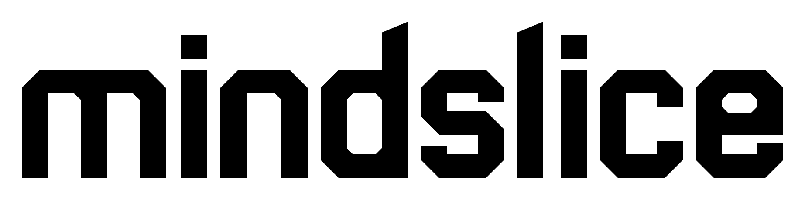

<p align="left"></p>

# Mindslice Homebrew tap

**Give your AI coding agents the context they need, across projects.**

Mindslice helps you organize knowledge as local Markdown and make the relevant
parts available to the projects and coding agents that need them. Connect your
projects to knowledge bases, search and read selected knowledge, and explore it
with a local browser-based reader.

Mindslice is currently an early, local-first release.

## Install

On macOS or Linux, install the Mindslice CLI with Homebrew:

```sh
brew install mindsliceai/tap/mindslice
```

Then start the local service, connect a knowledge base, and initialize your
project:

```sh
mindslice service start
mindslice connect
mindslice init .
```

Run `mindslice --help` to explore the available commands. To upgrade later:

```sh
brew upgrade mindslice
```

For other platforms, download an archive from
[Mindslice Releases](https://github.com/mindsliceai/mindslice-releases/releases).

## Maintainers

The private application repository's release workflow tests and builds the
platform bundles, publishes them with SHA-256 checksums to the public releases
repository, then opens a pull request updating this tap's formula. Merge that
pull request after the formula checks pass.

To publish an existing release, use the Release workflow's manual dispatch and
provide its stable `vMAJOR.MINOR.PATCH` tag. The first formula must be merged
before the Homebrew install command is available.

For cross-repository automation, install a GitHub App on
`mindsliceai/mindslice-releases` and `mindsliceai/homebrew-tap`, with
**Contents: read and write** and **Pull requests: read and write** permissions.
Add these repository secrets to the private `mindsliceai/mindslice`
application repository:

- `HOMEBREW_RELEASE_APP_ID`
- `HOMEBREW_RELEASE_APP_PRIVATE_KEY`
